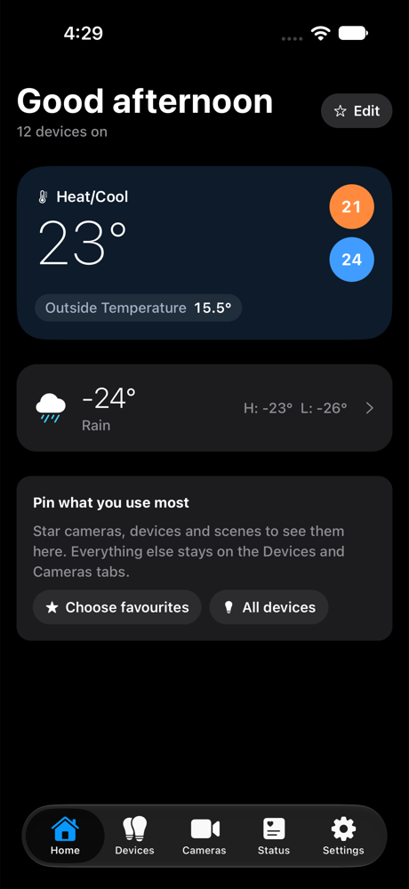
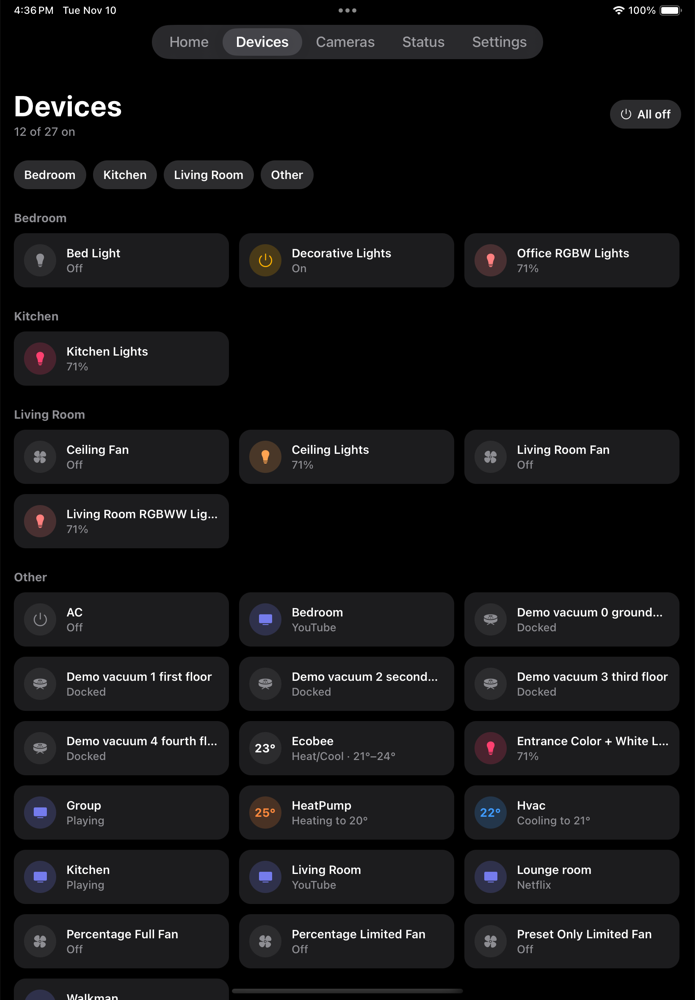

# Smart Home

A native iPhone and iPad app for [Home Assistant](https://www.home-assistant.io). It talks straight to your Home Assistant over your home network: no account, no cloud service, no analytics.

<p>
  
  
</p>

> Personal project, shared as is. It's built and tested around one house (Kasa, Govee over Matter, Ecobee, Echo, Blink, Google/Android TVs), so other setups may hit rough edges. Issues and pull requests are welcome.

## Features

- **Home:** the thermostat, weather and only what you star: devices, scenes and cameras.
- **Devices:** everything grouped by your Home Assistant areas, with a room-jump bar, room temperature and occupancy, and All off. Tap to switch, hold for quick actions (turn off in 30 minutes or an hour, favourite, settings), tap the name for the full settings sheet.
- **Timers, schedules and auto-off** for lights and switches. They're saved as ordinary Home Assistant automations, so they run with your phone off.
- **Scenes:** run any Home Assistant scene or script, or make your own in the app.
- **Cameras:** snapshots, live view with push-to-talk, motion clips, arming, and "who's at the door" alerts. Needs [Local Camera Vision](https://github.com/rohanjariwala03/ha-local-camera-vision) (Blink, RTSP and ONVIF cameras).
- **Status:** Home Assistant health and updates, offline devices, batteries, energy use.
- **Echo announcements** for the doorbell, motion and problems, with quiet hours. Needs [Alexa Media Player](https://github.com/alandtse/alexa_media_player).
- **Add and remove devices** without the Home Assistant app, including Matter pairing codes.
- **iPad wall dashboard** for a tablet by the door.
- **Home-screen and Lock Screen widgets, a Control Center toggle, Siri and Shortcuts, and an Apple Watch app.**
- Dark mode, large text and VoiceOver.

Nothing is hard-coded: devices come from Home Assistant by type, so whatever you add there shows up in the app.

## What you need

- Home Assistant, reachable from your iPhone on your home Wi-Fi.
- A Mac with Xcode and Node.js.
- An Apple developer account. A free account can install the app on your own iPhone, but it has to be reinstalled every 7 days and can't receive push alerts. The paid Apple Developer Program ($99/year) removes both limits.
- An iPhone or iPad on iOS 18 or later.

The app isn't on the App Store, so you build it yourself.

## Install

1. Get the code and its packages:

   ```bash
   git clone https://github.com/rohanjariwala03/smart-home.git
   cd smart-home
   npm install
   ```

2. Create a file named `.env.local` in the project folder with your Apple team and a bundle id of your own:

   ```bash
   APPLE_TEAM_ID=ABCDE12345            # developer.apple.com › Account › Membership details
   BUNDLE_ID=com.yourname.smarthome    # any unique reverse-domain name
   ```

   The file is git-ignored, so your team id stays on your Mac.

3. Connect your iPhone with a cable (or pair it with Xcode over Wi-Fi), unlock it, and run:

   ```bash
   npx expo run:ios --device --configuration Release
   ```

   The first time, Xcode may ask you to sign in to your Apple account and trust the developer certificate on the phone (Settings › General › VPN & Device Management).

4. In Home Assistant, create a token: your profile › Security › Long-lived access tokens.

5. Open the app, go to Settings › Address & token, and enter your Home Assistant address (for example `http://192.168.1.50:8123`) and the token.

A token from an admin user lets the app add devices, schedules and automations. If you only want control, a non-admin user is safer.

Expo Go can't run this app because of its widget, watch and native audio parts.

## Optional add-ons

| For | Install in Home Assistant |
|---|---|
| Cameras, live view, talk-back, clips, face alerts | [Local Camera Vision](https://github.com/rohanjariwala03/ha-local-camera-vision) (HACS) |
| Echo announcements | [Alexa Media Player](https://github.com/alandtse/alexa_media_player) (HACS) |
| Phone alerts with pictures | The `smarthome_push` integration in [`homeassistant/custom_components`](homeassistant/custom_components/smarthome_push) (see below) |
| Govee scenes, music mode and DreamView | A Govee API key, entered in the app's Settings |

### Push alerts

Alerts go from Home Assistant straight to Apple, so they need a paid developer account:

1. On developer.apple.com, create a key with Apple Push Notifications service (Certificates, Identifiers & Profiles › Keys) and download the `.p8` file.
2. Copy `homeassistant/custom_components/smarthome_push` into your Home Assistant's `config/custom_components/` folder and restart Home Assistant.
3. Add the **Smart Home app push** integration and enter your Team ID, the key's ID, the contents of the `.p8` file and your bundle id. Turn on "Development build" for apps installed from Xcode.

The key stays in Home Assistant, never in the app or this repository.

## Using it away from home

The app only talks to the address you give it. To use it away from home, put your phone and Home Assistant on the same private network, for example with the [Tailscale add-on](https://github.com/hassio-addons/addon-tailscale) and the Tailscale app on your phone, or use Home Assistant Cloud. **Don't port-forward Home Assistant to the internet.**

## Privacy and security

- Your token is stored only in the iOS Keychain and is never logged or sent anywhere except your Home Assistant.
- The widget, Siri and the watch use a copy in a keychain group only this app can read.
- Camera, Alexa and Govee accounts stay in Home Assistant.

## For developers

Expo SDK 57, React Native and Expo Router, with [`home-assistant-js-websocket`](https://github.com/home-assistant/home-assistant-js-websocket) for the connection. The widget, watch app and notification extension are Swift targets in `targets/` (via `@bacons/apple-targets`). The `ios/` folder is generated: native changes go in `app.json`, `app.config.js` and `plugins/`. There are no app tests; run `npx tsc --noEmit` and `npx expo lint` before sending a change.

### Code map

- `src/ha.tsx`: HA connection (via `home-assistant-js-websocket`: auth, reconnect, resubscribe), live entity and device registry, `call()` for services (resolves `false` on failure). Also decides what counts as a device: a switch on a camera, speaker, TV, light or fan (an Echo's Do Not Disturb, a Govee light's music mode) is a setting of that device, not a tile.
- `src/optimistic.ts`: switches and tiles flip the moment they're tapped and hold until HA reports the change (or 15 s), snapping back with an error buzz if the call fails.
- `src/app/index.tsx` + `src/favourites.tsx` + `components/favourites-sheet.tsx`: Home's favourites, kept in the Keychain. Edit opens a native SwiftUI list (drag to reorder). A copy in the shared keychain (`ha-favourites`) drives the widget when it isn't configured, puts favourites first in Siri's and Control Center's device lists, and goes to the watch.
- `src/app/devices.tsx` + `components/device-tile.tsx` + `components/device-sheet.tsx`: the Devices tab. Vacuums start or pause from the tile; an Echo plays or pauses. The sheet has the controls (light brightness, warmth and colour; vacuum dock, find and suction; TV power, volume, playback and input; Echo volume), rename, timers, schedules, other HA entities, alert switches, and Remove device.
- `components/device-extras.tsx` + `src/automations.ts`: fixed-id automations stored in HA, so they run with the phone off: timers (`smarthome_timer_*`, one-shot), away mode (`smarthome_away_*`), "When this turns on, also turn on…" (`smarthome_follow_*`, optionally only after dark), camera motion alerts (`smarthome_alert_*`), health alerts (`smarthome_health`) and announcements (`smarthome_announce`). Also activity history (HA `history/history_during_period`) and name & room editing.
- `src/schedules.ts` + `components/schedule-card.tsx`: schedules (time or sunrise/sunset, weekdays) and auto-off, saved as plain HA automations with `smarthome_*` ids, so they can also be edited in HA.
- `components/scene-list.tsx` + `src/scenes.ts` + `components/scene-editor.tsx`: run any HA scene or script, and make your own. App scenes are HA scripts (`script.smarthome_scene_*`), so Siri, widgets and the watch can run them. They can include TVs; Govee scenes ride in the script's variables and are applied by the app.
- `src/govee.tsx`: optional Govee cloud API key for scenes, music mode and DreamView on Matter-added Govee lights, which Matter doesn't expose.
- `src/app/cameras.tsx` + `components/camera-automations.tsx`: snapshots, motion, arming, per-camera alert switches, and automatic arming: at night (`smarthome_night_*`), when everyone leaves or returns (`smarthome_leave_*`, `smarthome_arrive_*`, from `zone.home`), and motion turns on lights (`smarthome_motionlight_*`). `smarthome://cameras?live=<slug>` opens a camera's live view; motion and doorbell alerts link there.
- `src/components/live-view.tsx`: gets a 10-minute token from Blink Instant Events (`/api/blink_instant_events/cameras/<slug>`) and plays its HLS stream (`/hls/index.m3u8`) in expo-video with the app's own controls. Hold the mic to talk: `modules/mic-stream` (local Expo module, Swift) streams 16-bit PCM to its `/ptt` WebSocket. Also camera settings (`/controls`), Record (`/last-liveview.mp4`) and full screen. `src/orientation.ts` keeps the app portrait and unlocks rotation on video screens.
- `components/clips.tsx`: the last 30 days of motion clips from the `/api/blink_instant_events/clips` API, to play or share.
- `components/live-grid.tsx` + `components/camera-strip.tsx`: all cameras live at once, and the camera row on Home.
- `src/app/status.tsx` + `components/energy-card.tsx`: health (HA version and updates, Blink connection and last poll, offline devices, batteries), per-camera health, and energy (live W, daily kWh from HA statistics). Its switch turns on the `smarthome_health` phone alert; each device can be muted from its sheet.
- `components/announce-settings.tsx`: Echo announcements for the doorbell, camera motion and home problems, with quiet hours. Each camera and device has its own Announce on Echo switch (on by default). The card lists anything that would stop an alert from being spoken, with one-tap fixes.
- `src/setup.ts` + `components/add-device.tsx` + `components/remove-devices.tsx`: add devices without the HA app (HA's discovered list, any integration by brand using HA's own setup forms, Matter pairing code over Wi-Fi) and remove them. Integrations that can't delete a device get it disabled instead. Brand-new Matter devices still pair over Bluetooth in the HA app.
- `targets/widget/Widget.swift`: home-screen widget (small, medium, large), Lock Screen widget, and a Control Center toggle (iOS 18). Taps run App Intents that call HA's REST API with the creds the app copies to the shared keychain group. Refreshes every 15 minutes and after each tap.
- `targets/widget/_shared/Home.swift`: the HA REST client and App Intents, compiled into both the app and the widget. Siri and Shortcuts use them ("Turn off <device> for an hour in Smart Home"). `plugins/with-app-shortcuts.js` registers device names with Siri at launch.
- `targets/watch/`: Apple Watch app (SwiftUI): camera snapshots with the doorbell first, device toggles, scenes, calling HA's REST API. `_shared/WatchSync.swift` hands it the URL, token and favourites over WatchConnectivity. It needs the iPhone nearby on home Wi-Fi.
- `plugins/with-scene-lifecycle.js`: the iOS 27 SDK requires the UIScene lifecycle, and Expo 57's template doesn't use it yet.

### Hub watchdog (Mac + UTM only)

If you run Home Assistant OS in a [UTM](https://mac.getutm.app) virtual machine on a Mac, `scripts/hub-watchdog.sh` keeps it running. Every 2 minutes, on your home network, it starts the VM if it's stopped, restarts it after about 6 minutes of Home Assistant not answering (at most once per 20 minutes), and copies Home Assistant's newest backup to `~/Home Assistant Backups`, keeping 7.

1. Create `scripts/hub-watchdog.env` (git-ignored):

   ```bash
   VM="Home Assistant"          # the UTM VM's name or id
   HA=http://192.168.1.50:8123  # Home Assistant's address
   GATEWAY=192.168.1.1          # your router; the script does nothing on other networks
   ```

2. In `scripts/com.smarthome.hub-watchdog.plist`, change `/path/to/smart-home` to where you cloned this repo, then:

   ```bash
   cp scripts/com.smarthome.hub-watchdog.plist ~/Library/LaunchAgents/
   launchctl load ~/Library/LaunchAgents/com.smarthome.hub-watchdog.plist
   ```

## License

MIT, see [LICENSE](LICENSE). Not affiliated with Home Assistant, Apple, Amazon, Blink or Govee.
